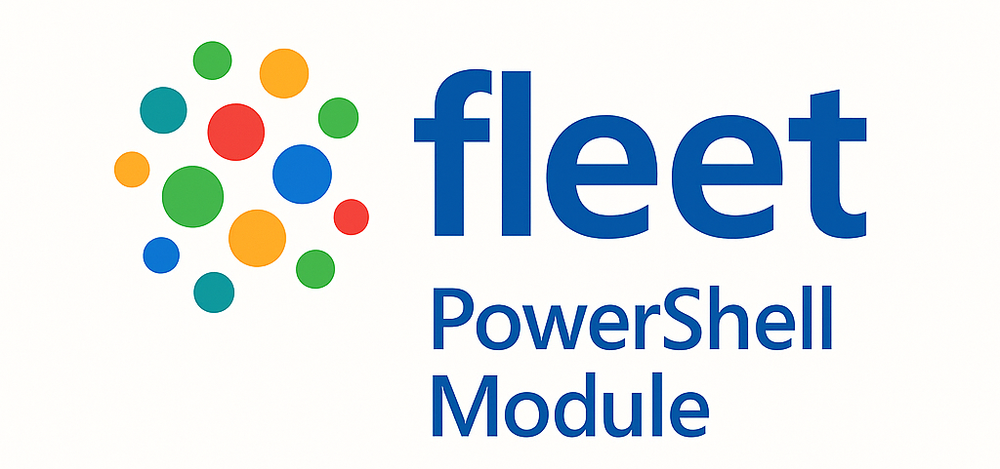

# FleetDM-PowerShell



A PowerShell module for the FleetDM REST API, including Fleet Free and optional Fleet Premium cmdlets.

[](https://github.com/Jorgeasaurus/FleetDM-PowerShell/actions/workflows/ci.yml)
[](https://jorgeasaurus.github.io/FleetDM-PowerShell/)
[](https://www.powershellgallery.com/packages/FleetDM-PowerShell)
[](https://www.powershellgallery.com/packages/FleetDM-PowerShell)
[](https://www.powershellgallery.com/packages/FleetDM-PowerShell)
[](https://github.com/Jorgeasaurus/FleetDM-PowerShell/releases/latest)
[](https://opensource.org/licenses/MIT)

## Overview

FleetDM-PowerShell provides a native PowerShell interface to Fleet. Free-tier cmdlets manage hosts, reports, policies, and software inventory. Premium cmdlets cover fleets, software installers, self-service categories, scripts, MDM lock and disk encryption, OS update enforcement, policy automations, calendar maintenance windows, and SSO just-in-time provisioning. Premium cmdlets call the same API and surface HTTP 402 from a Fleet Free server as a license error.

📚 **[View Full Documentation](https://jorgeasaurus.github.io/FleetDM-PowerShell/)** — install, connect, common tasks, and the cmdlet reference.

## Features

- **Free Tier**: Hosts, reports, policies, and software inventory without a Premium license
- **Fleet Premium**: Fleets, software install and uninstall, self-service categories, scripts, host lock and unlock, disk encryption, OS update enforcement, policy automations, calendar events, and SSO JIT provisioning
- **Host Management**: Query, filter, and manage FleetDM hosts
- **Query Execution**: Run live queries and saved reports against hosts
- **Policy Management**: Create, update, and monitor compliance policies, including fleet policies
- **Software Inventory**: Track installed software and vulnerabilities
- **Cross-Platform**: Works on Windows PowerShell 5.1+ and PowerShell Core 7+
- **Pipeline Support**: Full support for PowerShell pipeline operations
- **Simple Authentication**: Support for API tokens and credentials without external dependencies
- **Lightweight**: No SecretManagement or other complex dependencies
- **Comprehensive Help**: Detailed help for all cmdlets with examples

## Requirements

- PowerShell 5.1 or PowerShell Core 7.0+
- FleetDM server (4.0+). Fleet Premium cmdlets require a Premium license on that server
- FleetDM API token or credentials
- No external module dependencies

## Installation

### From PowerShell Gallery

```powershell
Install-Module -Name FleetDM-PowerShell -Force
```

### From Source

```powershell
# Clone the repository
git clone https://github.com/Jorgeasaurus/FleetDM-PowerShell.git
cd FleetDM-PowerShell

# Import directly without building
Import-Module ./FleetDM-PowerShell.psd1 -Force
```

## Quick Start

### Connect to FleetDM

```powershell
# Using API token (recommended - most secure)
$token = ConvertTo-SecureString "your-api-token-here" -AsPlainText -Force
Connect-FleetDM -BaseUri "https://fleet.example.com" -ApiToken $token

# Using username/password
$cred = Get-Credential
Connect-FleetDM -BaseUri "https://fleet.example.com" -Credential $cred
```

### Basic Operations

```powershell
# Get all hosts
Get-FleetHost

# Get specific host
Get-FleetHost -Id 123

# Filter hosts by status
Get-FleetHost -Status online

# Run a live query and get results directly
$results = Invoke-FleetQuery -Query "SELECT * FROM system_info;" -HostId 1,2,3
$results.Results | Format-Table

# Or use a saved query
$results = Invoke-FleetSavedQuery -QueryId 123 -HostId 1,2,3

# Get policies
Get-FleetPolicy

# Get software inventory
Get-FleetSoftware -VulnerableOnly
```

## Available Cmdlets

For detailed help and examples, visit the **[Online Documentation](https://jorgeasaurus.github.io/FleetDM-PowerShell/)** or use `Get-Help <cmdlet-name> -Full`.

### Connection Management

- `Connect-FleetDM` - Establish connection to FleetDM server
- `Disconnect-FleetDM` - Disconnect from FleetDM server

### Host Management

- `Get-FleetHost` - Retrieve host information
- `Remove-FleetHost` - Remove hosts from FleetDM

### Query Management

- `Get-FleetQuery` - List saved queries
- `Invoke-FleetQuery` - Execute live queries
- `Invoke-FleetSavedQuery` - Execute saved queries with direct results

### Policy Management

- `Get-FleetPolicy` - Retrieve policies
- `New-FleetPolicy` - Create new policies
- `Set-FleetPolicy` - Update existing policies

### Software Management

- `Get-FleetSoftware` - Retrieve software inventory
- `Install-FleetSoftware` - Install a software title on a host (Premium)
- `Uninstall-FleetSoftware` - Uninstall a software title from a host (Premium)
- `Get-FleetSoftwareInstall` - Read a package install result (Premium)
- `Remove-FleetSoftwarePackage` - Remove an installer from a fleet (Premium)
- `Get-FleetSelfServiceCategory` - List self-service categories (Premium)
- `New-FleetSelfServiceCategory` - Create a self-service category (Premium)
- `Set-FleetSelfServiceCategory` - Rename a self-service category (Premium)
- `Remove-FleetSelfServiceCategory` - Delete a self-service category (Premium)

### Fleets (Premium)

- `Get-FleetTeam` - List or get fleets (the REST resource is `/fleets`)
- `New-FleetTeam` - Create a fleet
- `Set-FleetTeam` - Rename a fleet or assign hosts
- `Remove-FleetTeam` - Delete a fleet

### Scripts

- `Get-FleetScript` - List or get saved scripts. `-FleetId` requires Premium
- `Invoke-FleetScript` - Run a script. `-FleetId` / `-ScriptName` requires Premium
- `Remove-FleetScript` - Delete a saved script

### MDM and automations (Premium)

- `Lock-FleetHost` - Lock a host
- `Unlock-FleetHost` - Unlock a host
- `Invoke-FleetHostWipe` - Wipe a host. Company-owned Android is Fleet Free; macOS, Windows, iOS, iPadOS, Linux, and personal Android require Premium
- `Get-FleetHostWipeStatus` - Read `mdm.device_status` and `mdm.pending_action`
- `Get-FleetDiskEncryption` - Disk encryption summary
- `Set-FleetDiskEncryption` - Enforce disk encryption
- `Set-FleetOsUpdate` - Enforce macOS, iOS, iPadOS, or Windows updates
- `Set-FleetCalendarEvent` - Enable calendar maintenance windows for a fleet
- `Get-FleetPolicyAutomation` - List policy automation activity
- `Reset-FleetPolicyAutomation` - Reset failing-policy automation state. `-FleetId` requires Premium
- `Set-FleetJitProvisioning` - Enable SSO just-in-time user provisioning

### Advanced

- `Invoke-FleetDMMethod` - Direct API access for unsupported endpoints

## Examples

### Example 1: Find and Remove Offline Hosts

```powershell
# Find hosts offline for more than 30 days
$offlineHosts = Get-FleetHost -Status offline | 
    Where-Object { $_.seen_time -lt (Get-Date).AddDays(-30) }

# Remove them (with confirmation)
$offlineHosts | Remove-FleetHost -Confirm
```

### Example 2: Check Policy Compliance

```powershell
# Get all policies with low compliance
Get-FleetPolicy | 
    Where-Object { $_.compliance_percentage -lt 80 } |
    Format-Table name, compliance_percentage, failing_host_count
```

### Example 3: Find Vulnerable Software

```powershell
# Get all software with critical vulnerabilities
Get-FleetSoftware -VulnerableOnly | 
    Where-Object { $_.highest_severity -eq 'critical' } |
    Sort-Object hosts_count -Descending |
    Select-Object name, version, hosts_count, cve_count
```

### Example 4: Run Query on Specific Platform

```powershell
# Get Ubuntu hosts and run a query
$ubuntuHosts = Get-FleetHost | Where-Object { $_.platform -eq 'ubuntu' }
$results = Invoke-FleetQuery -Query "SELECT * FROM os_version;" -HostId $ubuntuHosts.id

# View the results
$results.Results | ForEach-Object {
    Write-Host "Host: $($_.HostId)"
    $_.Rows | Format-Table
}
```

### Example 5: Create macOS Security Policy

```powershell
# Create a policy to check FileVault auto-login is disabled on macOS
New-FleetPolicy -Name "FileVault Auto-Login Disabled" `
    -Query "SELECT 1 FROM managed_policies WHERE domain = 'com.apple.loginwindow' AND name = 'DisableFDEAutoLogin' AND value = 1 LIMIT 1;" `
    -Platform darwin
```

### Example 6: Bulk Policy Creation

```powershell
# Import policies from CSV
Import-Csv policies.csv | ForEach-Object {
    New-FleetPolicy -Name $_.Name -Query $_.Query -Description $_.Description
}
```

## Pipeline Support

All cmdlets support pipeline operations:

```powershell
# Chain operations - get online Windows hosts
Get-FleetHost -Status online | 
    Where-Object { $_.platform -eq 'ubuntu' } |
    Select-Object id, hostname, seen_time

# Execute query on filtered hosts
$hostIds = Get-FleetHost | 
    Where-Object { $_.platform -eq 'debian' } |
    Select-Object -First 5 -ExpandProperty id
Invoke-FleetQuery -Query "SELECT * FROM system_info;" -HostId $hostIds

# Or pipe host IDs directly as an array
@(17,6,8) | Invoke-FleetQuery -Query "SELECT * FROM os_version;"
```

## Error Handling

The module retries a failed request before it throws:

- **HTTP 429** is retried for every method. The wait is the `Retry-After` header when Fleet sends one, otherwise `retry after: Ns` in the error. If neither is present, the wait is 2 seconds, then 4, then 8.
- **HTTP 502, 503, and 504** are retried for GET, with that same 2, 4, and 8 second backoff. POST, PUT, PATCH, and DELETE are not retried, so a software install or other change is not sent twice.
- The default is **3** extra attempts (`-MaxRetries`). `-Verbose` writes one line per retry. The last error is thrown after that. Pass `-MaxRetries 0` to `Invoke-FleetDMMethod` to disable retries for one call. Pass `-RetryNonIdempotent` only when repeating a POST, PUT, PATCH, or DELETE is safe.

```powershell
try {
    Get-FleetHost -Id 99999
}
catch {
    Write-Error "Failed to get host: $_"
}

# One direct call with no retry, or an explicit opt-in for a non-GET gateway retry.
Invoke-FleetDMMethod -Endpoint "hosts" -MaxRetries 0
Invoke-FleetDMMethod -Endpoint "hosts/123/refetch" -Method POST -RetryNonIdempotent
```

## Authentication

### API Token (Recommended)

The most secure method is using API tokens:

1. Generate an API token in FleetDM UI (Account → Get API Token)
2. For API-only users: `fleetctl user create --api-only`
3. Store token securely using SecureString
4. Tokens don't expire unless explicitly revoked

```powershell
# Store token securely
$token = Read-Host "Enter API Token" -AsSecureString
Connect-FleetDM -BaseUri "https://fleet.example.com" -ApiToken $token
```

### Username/Password

Less secure but available when tokens aren't accessible:

```powershell
$cred = Get-Credential
Connect-FleetDM -BaseUri "https://fleet.example.com" -Credential $cred

# Same login as: fleetctl login --email admin@example.com --password ...
$password = Read-Host "Password" -AsSecureString
Connect-FleetDM -BaseUri "https://fleet.example.com" -Email "admin@example.com" -Password $password

# Same create as: fleetctl user create --name module-test --email api@example.com --password ... --api-only --global-role admin
$apiPassword = Read-Host "API user password" -AsSecureString
$apiUser = New-FleetUser -Name "module-test" -Email "api@example.com" -Password $apiPassword -ApiOnly -GlobalRole admin
```

## Security Best Practices

1. **Never hardcode tokens** in scripts or source control
2. **Use SecureString** for token storage
3. **Create API-only users** for automation (requires admin access)
4. **Rotate tokens regularly**
5. **Use least-privilege principles** for API users
6. **Verbose logs are redacted.** `-Verbose`, transcripts, and CI logs redact `password`, token fields, and `Authorization` bearer values at any nesting depth. `New-FleetUser` still sends the password to Fleet. Redaction does not change the request URI sent to Fleet. Do not put a secret in `Invoke-FleetDMMethod -Endpoint`: that cmdlet writes the endpoint string to the verbose log before redaction.

## Development

For developers who want to contribute or modify the module:

```powershell
# Clone the repository
git clone https://github.com/Jorgeasaurus/FleetDM-PowerShell.git
cd FleetDM-PowerShell

# Import the module directly from source
Import-Module ./FleetDM-PowerShell.psd1 -Force

# Make your changes and test them
```

## Testing

Run the Pester tests:

```powershell
# Run all tests
Invoke-Pester

# Run specific test file
Invoke-Pester -Path .\Tests\Get-FleetHost.Tests.ps1

# Run with code coverage
Invoke-Pester -CodeCoverage @('Public\*.ps1', 'Private\*.ps1')
```

## Limitations

- **Premium license**: Fleet, installer, self-service, MDM, calendar, and JIT cmdlets return a license error on Fleet Free (HTTP 402). Wiping macOS, Windows, iOS, iPadOS, Linux, or personal Android also requires Premium. Company-owned Android wipe is available in Fleet Free
- **Scripts**: Running a script by ID or contents is available in Fleet Free. Targeting a fleet with `-FleetId` requires Premium
- **WebSocket connections**: Live campaign rows are not available via REST. Target host IDs to receive results in the session
- **Direct query results**: Only available when targeting specific host IDs
  - Queries using `-Label` or `-All` return campaign info only
- **Query result retrieval**: Has a timeout limit (default 25 seconds)
- **No persistent sessions**: Authentication is session-based without saved credentials

## Troubleshooting

### Connection Issues

```powershell
# Test connection
Test-NetConnection -ComputerName fleet.example.com -Port 443

# Enable verbose output. Passwords and bearer tokens are redacted in that log.
Connect-FleetDM -BaseUri "https://fleet.example.com" -ApiToken $token -Verbose
```

### SSL/TLS Issues

```powershell
# For self-signed certificates (not recommended for production)
[System.Net.ServicePointManager]::ServerCertificateValidationCallback = {$true}
```

### Module Import Issues

```powershell
# Force reload module
Remove-Module FleetDM-PowerShell -Force -ErrorAction SilentlyContinue
Import-Module FleetDM-PowerShell -Force -Verbose

# Or import directly from source
Import-Module ./FleetDM-PowerShell.psd1 -Force
```

## Contributing

Contributions are welcome! Please:

1. Fork the repository
2. Create a feature branch (`git checkout -b feature/AmazingFeature`)
3. Commit your changes (`git commit -m 'Add some AmazingFeature'`)
4. Push to the branch (`git push origin feature/AmazingFeature`)
5. Open a Pull Request

### Development Guidelines

- Follow PowerShell best practices
- Add Pester tests for new functionality
- Update documentation and examples
- Ensure backward compatibility
- Use approved PowerShell verbs

## CI/CD Pipeline

The project uses GitHub Actions for continuous integration:

- **Build**: Runs on Windows, Linux, and macOS
- **Tests**: Automated Pester tests (98%+ pass rate achieved)
- **Analysis**: PSScriptAnalyzer checks
- **Publishing**: Automatic deployment to PowerShell Gallery on version tags

## License

This project is licensed under the MIT License - see the [LICENSE](LICENSE) file for details.

## Author

- **Jorge Suarez** - [Jorgeasaurus](https://github.com/Jorgeasaurus)

## Acknowledgments

- FleetDM team for the excellent API documentation
- PowerShell community for best practices and patterns
- Contributors and testers

## Documentation

- **📚 Full Documentation**: [https://jorgeasaurus.github.io/FleetDM-PowerShell/](https://jorgeasaurus.github.io/FleetDM-PowerShell/)
- **Built-in Help**: Use `Get-Help <cmdlet-name> -Full` for detailed cmdlet documentation
- **Interactive Viewer**: Run `./Show-Documentation.ps1` for local documentation browsing

## Support

- **Issues**: [GitHub Issues](https://github.com/Jorgeasaurus/FleetDM-PowerShell/issues)
- **FleetDM Docs**: [https://fleetdm.com/docs](https://fleetdm.com/docs)
- **PowerShell Gallery**: [FleetDM-PowerShell](https://www.powershellgallery.com/packages/FleetDM-PowerShell)

## Version History

### 2.2.1 - Fleet list responses and request retries

- `Get-FleetTeam` returns fleets when Fleet sends the same list under both `teams` and `fleets`
- Requests retry HTTP 429 for every method, and HTTP 502, 503, and 504 for GET, up to 3 extra attempts

### 2.2.0 - Premium cmdlets and API fixes

- Fixed pagination, query-string encoding, single-element JSON arrays, report routes, host filters, and Fleet Premium HTTP 402/403 errors
- Added Fleet Premium cmdlets for fleets, software installers, self-service, scripts, MDM, host wipe, OS updates, policy automations, calendar, and SSO JIT provisioning
- Added `Connect-FleetDM -Email`/`-Password` and `New-FleetUser` for API-only users
- Verbose logs redact passwords, token fields, and Authorization bearer values

### 1.0.0 - Initial Release

- Core host, query, policy, and software management
- Full pipeline support
- Cross-platform compatibility
- Secure authentication with API tokens
- Comprehensive test coverage
- CI/CD pipeline with GitHub Actions

## Roadmap

- [x] **Fleet Premium cmdlets**: Fleets, installers, self-service, scripts, MDM, host wipe, automations, calendar, and JIT provisioning
- [x] **Free Tier Focus**: Module optimized for FleetDM Free Tier users
- [x] **Simplified Authentication**: Removed complex SecretManagement dependencies
- [x] **High Test Coverage**: Achieved 98%+ test pass rate
- [ ] Add more granular error handling
- [ ] Add performance optimizations for large fleets
- [ ] Create advanced reporting cmdlets
- [ ] Add support for additional Free Tier features as FleetDM evolves
